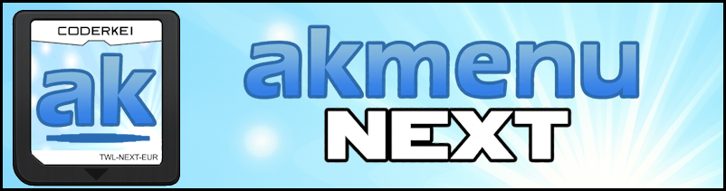

{ align=right width="200"}
# Installing AKMenu-Next

!!! info

    [AKMenu-Next](https://github.com/coderkei/akmenu-next) is an enhanced, actively developed take on the Acekard/Wood menu (forked from [akmenu4](https://github.com/lifehackerhansol/akmenu4)) that runs Nintendo DS software & homebrew through nds-bootstrap & Pico-Loader. It adds DSiWare support, cheats, plugins, per-game settings and an upgraded theme system with game covers and music, while still supporting Acekard/Wood themes.
    For in-game controls such as soft-reset, see the [nds-bootstrap controls page](https://wiki.ds-homebrew.com/nds-bootstrap/controls).

Pick the tab for your setup below. Not sure which one you need? There's a table on the [home page](../index.md#which-version-do-i-need).

!!! tip "Before you start"

    - You'll need [7-Zip](https://www.7-zip.org/) (or any extractor that handles `.zip` and `.7z`).
    - Use a decent, genuine SD card. A lot of "corrupted files" and "theme missing" problems turn out to be fake or dying cards, so if your card is new it's worth [testing it](https://www.flashcarts.net/microsd-fakes#testing-a-microsd-card) first.
    - All the paths in this guide are from the **root** of your SD card, i.e. the top level, not inside another folder.

### Setup Guide

=== "Flashcarts"

    #### Installing AKMenu-Next Flashcart Edition

    1. Download the latest release of [AKMenu-Next Flashcart Edition](https://github.com/coderkei/akmenu-next/releases/latest/download/akmenu-next-flashcart.zip).

    1. Extract the downloaded `akmenu-next-flashcart.zip` file with [7-Zip](https://www.7-zip.org/).

    1. Copy the following files/folders to the root of your SD card:

        - `_nds` folder
        - `_pico` folder
        - `BOOT.NDS`

        !!! warning "Already using TWiLight Menu++ or another menu?"

            If there's already a `BOOT.NDS` on your SD card that something else relies on, rename the AKMenu-Next one (e.g. `akmenu-next.nds`) before copying it over, then launch it from your kernel.

    #### Installing a game loader

    AKMenu-Next doesn't run DS games by itself, it hands them off to a loader. You need **at least one** of these. You can install both and switch between them whenever you like, even per game.

    - **Pico-Loader** only supports certain flashcarts, but if yours is on the list it's a good choice.
    - **nds-bootstrap** works on pretty much any flashcart that can run homebrew. The Flashcart Edition uses nds-bootstrap by default.

    === "Pico-Loader"

        !!! warning
            Using the wrong version of Pico-Loader could damage your flashcart!
            If you are unsure which version to use, check the [Supported Platforms section](https://github.com/LNH-team/pico-loader?tab=readme-ov-file#supported-platforms). If your flashcart isn't listed, use nds-bootstrap instead.

        1. Download the latest release of [Pico-Loader](https://github.com/LNH-team/pico-loader/releases/latest). Pick the zip that matches your flashcart, using the [Supported Platforms table](https://github.com/LNH-team/pico-loader#supported-platforms) to work out which one that is.

        1. Extract the downloaded `Pico_Loader_YOUR_FLASHCART_HERE.zip` file with [7-Zip](https://www.7-zip.org/).

        1. Copy the *contents* of the zip into the `_pico` folder on your SD card (create it if it isn't there). When you're done, you should have `_pico/picoLoader7.bin` and `_pico/picoLoader9.bin`.

        1. Boot AKMenu-Next, press `START` and go to `Settings`. In the `Game loader settings` tab, change `Game Loader` to `Pico-Loader`, then press `A` and confirm to save.

    === "nds-bootstrap"

        1. Download the latest release of [nds-bootstrap](https://github.com/DS-Homebrew/nds-bootstrap/releases/latest/download/nds-bootstrap.zip).

        1. Extract the downloaded `nds-bootstrap.zip` file with [7-Zip](https://www.7-zip.org/).

        1. Copy the *contents* of the zip into the `_nds` folder on your SD card. You should end up with files like `_nds/nds-bootstrap-release.nds` and `_nds/nds-bootstrap-hb-release.nds`.

        1. That's it, nds-bootstrap is already the default loader on the Flashcart Edition. If you've previously switched to Pico-Loader, press `START`, go to `Settings` > `Game loader settings` and set `Game Loader` back to `nds-bootstrap`.

        !!! note

            The first time you launch a game with nds-bootstrap you'll get a message about first-time setup. It creates a large `pagefile.sys` in `_nds`, which can take a minute. This only happens once.

    You can now launch `BOOT.NDS` from your flashcart's kernel, or set up autobooting below so you go straight into AKMenu-Next.

    #### Autobooting AKMenu-Next

    !!! note

        If you can't find your flashcart in the `Autoboot` folder (check `Autoboot/README.txt` too, as a lot of clones share files), skip this section and just launch `BOOT.NDS` from your kernel. On some kernels you can make a copy of `BOOT.NDS` called `default.nds` to have it chainload automatically.

    1. Open the `Autoboot` folder in the AKMenu-Next files and find the folder that matches your flashcart.

    1. Copy the *contents* of that folder (not the folder itself) to the root of your SD card. Overwrite anything it asks about.

    1. If your flashcart is a DSTTi clone that needs extra boot files, look in the `Supplementary DSTTi Clone Files` folder. The [YSMenu compatibility list](https://www.flashcarts.net/ysmenu-compat-ext) can tell you which file your cart wants. If it isn't there, make copies of `TTMenu.dat` from the `DSTT & DSTTi` folder and rename them to whatever your cart needs.

    !!! tip "Slot-1 carts that need DLDI patching"

        Most kernels DLDI patch homebrew for you. A few, like the Games n' Music, or Slot-2 carts booted into NDS mode, might not. If AKMenu-Next can't see your SD card, DLDI patch `BOOT.NDS` with your cart's driver first.

    #### Cheats (optional)

    1. Download a [cheat database](https://gbatemp.net/threads/deadskullzjrs-nds-i-cheat-databases.488711).

    1. Copy `usrcheat.dat` from the download to `_nds/akmenunext/cheats/` on your SD card (create the `cheats` folder if it's missing).

    See [Using the Menu](using.md#cheats) for how to actually turn cheats on.

=== "DSpico"

    #### Installing AKMenu-Next DSpico Edition

    1. Download the latest release of [AKMenu-Next DSpico Edition](https://github.com/coderkei/akmenu-next/releases/latest/download/akmenu-next-pico.zip).

    1. Extract the downloaded `akmenu-next-pico.zip` file with [7-Zip](https://www.7-zip.org/).

    1. Copy the following files/folders to the root of your DSpico's SD card:

        - `_nds` folder
        - `_pico` folder
        - `BOOT.NDS`
        - `_picoboot.nds` (only if you want to autoboot AKMenu-Next instead of Pico-Launcher)

    #### Installing Pico-Loader

    1. Download the latest release of [Pico-Loader for DSpico](https://github.com/LNH-team/pico-loader/releases/latest/download/Pico_Loader_DSPICO.zip).

    1. Extract the downloaded `Pico_Loader_DSPICO.zip` file with [7-Zip](https://www.7-zip.org/).

    1. Copy the *contents* of the zip into the `_pico` folder on your SD card. You should end up with `_pico/picoLoader7.bin` and `_pico/picoLoader9.bin`.

    1. You can now launch `BOOT.NDS` from Pico-Launcher. If you copied `_picoboot.nds`, the DSpico will boot straight into AKMenu-Next instead.

    !!! info "nds-bootstrap installation (Optional)"

        1. Download the latest release of [nds-bootstrap](https://github.com/DS-Homebrew/nds-bootstrap/releases/latest/download/nds-bootstrap.zip).

        1. Extract the downloaded `nds-bootstrap.zip` file with [7-Zip](https://www.7-zip.org/).

        1. Copy the *contents* of the zip into the `_nds` folder on your SD card.

        1. In AKMenu-Next, press `START` and go to `Settings`. Go to the `Game loader settings` tab and change `Game Loader` to `nds-bootstrap`. You can also leave the global setting on Pico-Loader and only switch individual games over (see [per-game settings](using.md#per-game-settings)).

    #### Cheats (optional)

    1. Download a [cheat database](https://gbatemp.net/threads/deadskullzjrs-nds-i-cheat-databases.488711).

    1. Copy `usrcheat.dat` from the download to `_nds/akmenunext/cheats/` on your SD card (create the `cheats` folder if it's missing).

    See [Using the Menu](using.md#cheats) for how to actually turn cheats on.

    #### Running DSiWare (DSi & 3DS only)

    The DSpico can run DSiWare when it's plugged into a DSi or 3DS. See [Running DSiWare](dsiware.md#dspico).

=== "Nintendo DSi"

    !!! note

        This needs a modded Nintendo DSi. If yours isn't modded yet, follow [dsi.cfw.guide](https://dsi.cfw.guide) first.

    #### Installing AKMenu-Next Nintendo DSi Edition

    1. Download the latest release of [AKMenu-Next DSi Edition](https://github.com/coderkei/akmenu-next/releases/latest/download/akmenu-next-dsi.zip).

    1. Extract the downloaded `akmenu-next-dsi.zip` file with [7-Zip](https://www.7-zip.org/).

        !!! warning

            If you use TWiLight Menu++ and want to keep it alongside AKMenu-Next, **don't** copy over `BOOT.NDS`, as it'll overwrite the one TWiLight Menu++ uses.
            Launch `akmenu-next.dsi` from TWiLight Menu++ or Unlaunch instead.

    1. Copy the following files/folders to the root of your SD card:

        - `_nds` folder
        - `BOOT.NDS` (read the warning above)
        - `akmenu-next.dsi`
        - `title` folder (only if you use HiyaCFW)

    1. Download the latest release of [nds-bootstrap](https://github.com/DS-Homebrew/nds-bootstrap/releases/latest/download/nds-bootstrap.zip).

    1. Extract the downloaded `nds-bootstrap.zip` file with [7-Zip](https://www.7-zip.org/).

    1. Copy the *contents* of the zip into the `_nds` folder on your SD card.

    1. Load `BOOT.NDS` with whatever entrypoint you use (e.g. Memory Pit, stylehax or Flipnote Lenny), or launch `akmenu-next.dsi` from Unlaunch or TWiLight Menu++. If you use HiyaCFW and copied the `title` folder, AKMenu-Next will show up on your home menu as an app.

    #### Cheats (optional)

    1. Download a [cheat database](https://gbatemp.net/threads/deadskullzjrs-nds-i-cheat-databases.488711).

    1. Copy `usrcheat.dat` from the download to `_nds/akmenunext/cheats/` on your SD card (create the `cheats` folder if it's missing).

    See [Using the Menu](using.md#cheats) for how to actually turn cheats on.

    #### Autobooting AKMenu-Next

    !!! note
        Autobooting AKMenu-Next on a DSi needs [Unlaunch](https://dsi.cfw.guide/installing-unlaunch.html) or [Astronaut](https://github.com/Vickerinox/Astronaut/releases/latest) installed.

    === "Unlaunch Users"

        1. Turn on your DSi while holding `A` and `B`.

        1. In the Unlaunch menu, go to `OPTIONS`.

        1. Set `NO BUTTON` (or a button of your choice) to the `akmenu-next` entry. The bottom screen should show `akmenu-next.dsi` when it's selected.

        1. Turn your DSi off and back on. It'll now boot straight into AKMenu-Next.

    === "Astronaut Users"

        1. Turn on your DSi while holding `A` and `B`.

        1. In the Astronaut menu, go to `Settings`, then `Change Boot Options`.

        1. Select `default boot option` and choose `Launch something from SD`.

        1. Find `akmenu-next.dsi` on the SD card and select it.

        1. Press `go back` at the bottom, then `Save` on the previous screen.

        1. Turn your DSi off and back on. It'll now boot straight into AKMenu-Next.

    #### Running DSiWare

    AKMenu-Next can launch DSiWare from your DSi's SD card. See [Running DSiWare](dsiware.md#dsi-and-3ds-sd-card).

=== "Nintendo 3DS"

    !!! note

        This needs a modded Nintendo 3DS. If yours isn't modded yet, follow [3ds.hacks.guide](https://3ds.hacks.guide) first. Everything here works the same on the 2DS family, it's just called "3DS" below to keep things short.

    #### Installing AKMenu-Next Nintendo 3DS Edition

    1. Download the latest release of [AKMenu-Next 3DS Edition](https://github.com/coderkei/akmenu-next/releases/latest/download/akmenu-next-3ds.zip).

    1. Extract the downloaded `akmenu-next-3ds.zip` file with [7-Zip](https://www.7-zip.org/).

        !!! warning

            If you use TWiLight Menu++ on your 3DS and want to keep it, **don't** copy over `BOOT.NDS`, as it'll overwrite the one TWiLight Menu++ uses. You don't need it anyway since you'll be launching AKMenu-Next from the home menu.

    1. Copy the following files/folders to the root of your SD card:

        - `_nds` folder
        - `BOOT.NDS` (read the warning above)
        - `akmenu-next.cia`

    1. Download the latest release of [nds-bootstrap](https://github.com/DS-Homebrew/nds-bootstrap/releases/latest/download/nds-bootstrap.zip).

    1. Extract the downloaded `nds-bootstrap.zip` file with [7-Zip](https://www.7-zip.org/).

    1. Copy the *contents* of the zip into the `_nds` folder on your SD card.

    1. Put the SD card back in your 3DS and turn it on. Open FBI, go to `SD`, find `akmenu-next.cia`, select it and choose `Install CIA`.

    1. Launch `akmenu-next` from the 3DS home menu.

    !!! tip

        If AKMenu-Next doesn't show up on the home menu after installing (or you're updating an older version), restart your 3DS.

    Once it's installed you can delete `akmenu-next.cia` from your SD card if you want the space back.

    #### Cheats (optional)

    1. Download a [cheat database](https://gbatemp.net/threads/deadskullzjrs-nds-i-cheat-databases.488711).

    1. Copy `usrcheat.dat` from the download to `_nds/akmenunext/cheats/` on your SD card (create the `cheats` folder if it's missing).

    See [Using the Menu](using.md#cheats) for how to actually turn cheats on.

    #### Running DSiWare

    AKMenu-Next can launch DSiWare from your 3DS's SD card through nds-bootstrap. See [Running DSiWare](dsiware.md#dsi-and-3ds-sd-card).

## First boot

The first time AKMenu-Next starts, it'll ask you to pick a language. Choose one and it'll restart into the menu. You can change it later in the `System settings` tab of the settings menu.

After that you'll see the top level of the file browser. What's listed depends on your setup:

| Setup | What you'll see |
| --- | --- |
| Flashcart in a DS / DS Lite | microSD Card, Favourites, Recently Played, Slot 2 Card |
| Flashcart or DSpico in a DSi / 3DS | microSD Card, DSi SD (if a card is in the console), Favourites, Recently Played, Slot 2 Card |
| DSi / 3DS SD card | DSi SD, Favourites, Recently Played, Slot 1 Card |

Head into your SD card, find a game and press `A`. Have a look at [Using the Menu](using.md) for everything else.

### What your SD card should look like

Here's roughly what you'll have once everything is installed. You don't need to match it exactly, but if something isn't working it's a handy thing to compare against:

```text
SD:/
├── _nds/
│   ├── akmenunext/            <- AKMenu-Next's own files
│   │   ├── cheats/usrcheat.dat
│   │   ├── language/
│   │   ├── plugins/
│   │   ├── ui/                <- themes go in here
│   │   ├── globalsettings.ini <- created on first boot
│   │   └── launcher.nds
│   ├── nds-bootstrap-release.nds
│   ├── nds-bootstrap-hb-release.nds
│   └── nds-bootstrap-nightly.nds (optional)
├── _pico/                     <- flashcart & DSpico only
│   ├── picoLoader7.bin
│   └── picoLoader9.bin
├── BOOT.NDS
└── (your games, in whatever folders you like)
```

!!! info

    Need help or want to chat about AKMenu-Next? Check out the [AKMenu-Next GBAtemp thread](https://gbatemp.net/threads/ds-i-3ds-akmenu-next-wood-frontend-for-nds-bootstrap-pico-loader.665743/).
