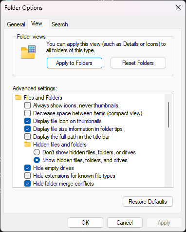

# Running DSiWare

AKMenu-Next can run DSiWare in two ways, depending on your setup:

| Setup | Works? | How |
| --- | --- | --- |
| Modded DSi, running AKMenu-Next from the console's SD card | Yes | nds-bootstrap, Unlaunch or Astronaut |
| Modded 3DS, running AKMenu-Next from the console's SD card | Yes | nds-bootstrap |
| DSpico in a DSi or 3DS | Yes | Pico-Loader |
| Any flashcart (including DSpico) in a DS or DS Lite | No | The DS and DS Lite don't have the hardware to run DSi software |
| Other flashcarts in a DSi or 3DS | No | Most flashcarts run in DS mode only. If your console is modded, put your DSiWare on the console's SD card instead |

DSiWare dumps need to end in `.nds`, `.dsi`, `.srl` or `.ids` for AKMenu-Next to pick them up. If yours has no extension at all, or is called something like `00000000.app`, just rename it to something like `Flipnote Studio.nds`.

## DSi and 3DS SD card

This is for the DSi and 3DS editions of AKMenu-Next, running from the SD card inside the console.

1. Make sure nds-bootstrap is installed in the `_nds` folder on your SD card (the install guide covers this).

1. Copy your DSiWare onto the SD card. You can put it in any folder you like, a `DSiWare` folder on the root keeps things tidy.

1. Launch it from AKMenu-Next like any other game.

That's all there is to it on a 3DS.

### Using Unlaunch or Astronaut to boot DSiWare (DSi only)

On a DSi with [Unlaunch](https://dsi.cfw.guide/installing-unlaunch.html) installed, you can have AKMenu-Next hand DSiWare over to Unlaunch instead of nds-bootstrap. This runs the title more like it would from the system menu, so it's worth a try if something doesn't work properly through nds-bootstrap.

Got [Astronaut](https://github.com/Vickerinox/Astronaut/releases/latest) instead? That works exactly the same way, since Astronaut supports launching DSiWare just like Unlaunch does. Everything below applies to both. The option is still called `Unlaunch` in the settings, so just pick that.

- To use Unlaunch for **all** DSiWare, go to `Settings` > `Game loader settings` and set `DSiWare booter` to `Unlaunch`.
- To use it for **one** title, highlight it, press `Y`, then `Y` again for its settings, and change `DSiWare booter` there.

AKMenu-Next quietly falls back to nds-bootstrap if Unlaunch can't be used: if neither Unlaunch nor Astronaut is installed, if the title is 64MB or bigger, or if you're on a 3DS (which can't run either of them).

### Saves

DSiWare doesn't use `.sav` files. Instead, each title can have a public save (`.pub`) and/or a private save (`.prv`). AKMenu-Next reads the sizes from the title itself and creates blank ones the first time you play, so you don't need to make them yourself.

Where they go:

- **nds-bootstrap** uses saves sitting right next to the ROM (e.g. `DSiWare/Flipnote.pub`) if they're already there. If not, they go wherever your normal save settings say, so with `Use 'saves' folder` turned on that's `DSiWare/saves/Flipnote.pub`.
- **Unlaunch / Astronaut** always needs the saves right next to the ROM. If they're in a `saves` folder, AKMenu-Next moves them next to the ROM for you before booting.

If you already have saves from TWiLight Menu++ or a NAND dump, rename them to match the ROM's name and put them next to it, e.g. `Flipnote.nds`, `Flipnote.pub`, `Flipnote.prv`.

## DSpico

!!! info "Console compatibility"

    This only works with your DSpico plugged into a DSi or 3DS. It won't work on an original DS or DS Lite, as those don't have the DSi hardware needed for DSi-mode software.

To run DSiWare (and encrypted DS ROMs), Pico-Loader needs some files dumped from your console first. You only need to do this once.

1. Download the [DSpico BIOS and NAND dumper utility](https://files.deletecat.com/projects/pico_file_dump/current/pico_file_dump.nds).

1. Put `pico_file_dump.nds` on the root of your DSpico's SD card.

1. Make a `DSiWare` folder on the root of the SD card, and put any DSiWare you'd like to play inside.

1. Put the SD card back in your DSpico and boot into it.

1. Find `pico_file_dump.nds` in the menu and launch it. It'll start dumping straight away.

1. Once it says it's finished, press the power button to turn the console off.

1. Boot into AKMenu-Next and make sure `Game Loader` in `Settings` > `Game loader settings` is set to `Pico-Loader`.

1. That's it! Head into your `DSiWare` folder and launch something.

!!! note

    If your DSi/3DS is modded and has an SD card in it, you'll also see a `DSi SD` entry at the top level of AKMenu-Next. DSiWare launched from there goes through nds-bootstrap (installed on the *console's* SD card), not Pico-Loader. That's what the [DSi and 3DS SD card](#dsi-and-3ds-sd-card) section above is about.

### Optional: tidying up your SD card

The dumper copies quite a few NAND folders onto your SD card. They need to stay there, but if you don't want to see them in the file list you can mark them as hidden. AKMenu-Next doesn't show hidden files unless you turn on `Show hidden files` in the settings.

Folders and files worth hiding:

- `_pico` folder
- `photo` folder
- `shared1` folder
- `shared2` folder
- `sys` folder
- `_picoboot.nds`
- `boot.nds`

Since the BIOS and NAND files have already been dumped, you can also delete `pico_file_dump.nds` now.

=== "Windows"

    1. Open the SD card in File Explorer.

    1. Hold `Ctrl` and click each of the files and folders you want to hide.

    1. Right click one of the selected items and choose `Properties`.

    1. Under `Attributes`, tick `Hidden`, then press `OK`.

    1. If it asks, choose "Apply changes to the selected items, subfolders, and files", then press `OK`.

    1. They'll disappear from File Explorer, that's normal. You can see them again by turning on "Show hidden files" in File Explorer's "Folder Options".

        {width="300"}

=== "macOS"

    1. Open Terminal and go to your SD card. Replace `SDCARD` with your card's name as it appears in Finder:

        ```bash
        cd /Volumes/SDCARD
        ```

    1. Hide the files and folders:

        ```bash
        chflags hidden _pico photo shared1 shared2 sys _picoboot.nds boot.nds
        ```

    To unhide something later, run the same command with `nohidden` instead of `hidden`.

=== "Linux"

    You'll need the `fatattr` tool (it's in most distros' repos, e.g. `sudo apt install fatattr`). Then, from the root of your mounted SD card:

    ```bash
    fatattr +h _pico photo shared1 shared2 sys _picoboot.nds boot.nds
    ```

    Use `-h` instead of `+h` to unhide them again.

Put the SD card back in your DSpico and boot into the menu. The hidden stuff won't show up any more, but DSiWare will still work.

!!! tip

    Files and folders starting with a `.` are hidden in AKMenu-Next too, so the `._` files macOS likes to leave everywhere won't clutter up your list.
