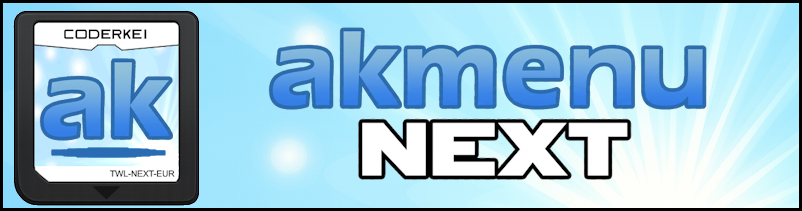

# Welcome!
{width="300"}

AKMenu-Next is a menu for your DS, DSi or 3DS that lets you browse your SD card and launch games and homebrew through [nds-bootstrap](https://github.com/DS-Homebrew/nds-bootstrap) or [Pico-Loader](https://github.com/LNH-team/pico-loader). It takes the classic Acekard/Wood menu (via [akmenu4](https://github.com/lifehackerhansol/akmenu4)) and builds a lot on top of it: modern loaders, DSiWare, game covers, theme music, plugins, per-game settings and loads more. Its upgraded theme system adds covers, music, custom icons and extra top-screen options, and your favourite Acekard and Wood themes still work too!

Some of the things it can do:

- Run DS games with nds-bootstrap or Pico-Loader, with per-game settings
- Cheats from a `usrcheat.dat` database
- DSiWare on a DSi/3DS SD card or a DSpico
- Themes, game covers and theme music
- Plugins for opening other file types (emulators, video players and so on)
- Favourites, Recently Played, multiple save slots and more

## Which version do I need?

There's a separate download for each kind of setup. Grab the one that matches what you're running it on:

| You have... | Install guide | Loader |
| --- | --- | --- |
| A DS flashcart (R4, Acekard, DSTT, etc.) | [Flashcart Edition](guides/akmenu-next.md#flashcarts) | Pico-Loader or nds-bootstrap |
| A DSpico | [DSpico Edition](guides/akmenu-next.md#dspico) | Pico-Loader (nds-bootstrap optional) |
| A modded DSi, running from the console's own SD card | [DSi Edition](guides/akmenu-next.md#nintendo-dsi) | nds-bootstrap |
| A modded 3DS/2DS, running from the console's own SD card | [3DS Edition](guides/akmenu-next.md#nintendo-3ds) | nds-bootstrap |

If you're using a flashcart *in* a DSi or 3DS, you still want the flashcart (or DSpico) version. The DSi and 3DS versions are only for running off the console's own SD card slot.

## Getting started

- [**Installing AKMenu-Next**](guides/akmenu-next.md)
- [**Updating AKMenu-Next**](guides/updating.md)

## Using AKMenu-Next

- [**Using the Menu**](guides/using.md) - controls, favourites, file info, saves and cheats
- [**Settings**](guides/settings.md) - what every option in the settings menu does
- [**Running DSiWare**](guides/dsiware.md)

## Customising

- [**Themes**](guides/themes.md) - installing themes, covers and making your own
- [**Plugins**](guides/plugins.md) - opening other file types, and making your own plugins

## Help

- [**FAQ**](guides/faq.md)
- [**Troubleshooting**](guides/troubleshooting.md)

!!! info "Need a hand?"

    If you're stuck, ask in the [AKMenu-Next GBAtemp thread](https://gbatemp.net/threads/ds-i-3ds-akmenu-next-wood-frontend-for-nds-bootstrap-pico-loader.665743/). For bugs or feature requests, open an issue on the [AKMenu-Next issue tracker](https://github.com/coderkei/akmenu-next/issues).
